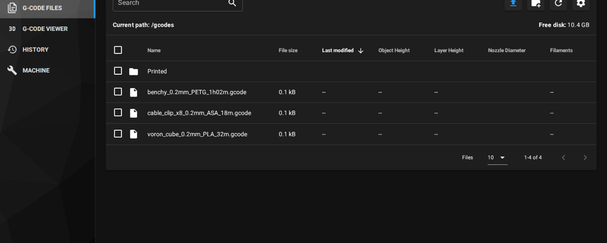

<!-- DRAFT artwork: docs/images/banner-draft.png is an AI-generated concept, not a final logo. Replace before release. -->
<p align="center"></p>

# KOS

A small Debian 13 (trixie) image that turns a **BigTreeTech CB1** or a **Raspberry Pi CM5** into a Klipper printer
host. Klipper, Moonraker and Mainsail are installed and tuned. You set it up by editing one text file on the SD card.

The goal, and the V1 acceptance test: flash the card, drop your existing `printer.cfg` on it, boot, and the printer
is ready. CAN and USB toolhead boards are found automatically. The web UI is on port 80 at `http://<printer>.local`.

The name comes from Kos, the Greek island, as a nod to Klipper.

> **Status: unreleased, no download yet.** Build the image from source (see [Building](#building)).
> Both images boot and print on real hardware: a CM5 Lite (4 GB) and a CB1 (1 GB), each on a BTT Manta M5P carrier.
> The CM4 also boots from the CM5 image in theory, but nobody has tested it. Details of what is verified:
> [plan §21](docs/plan.md#21-implementation-status) and [benchmarks](docs/benchmarks.md).

## Supported hardware

| Board | Kernel | Tested |
|---|---|---|
| BigTreeTech CB1 (Allwinner H616, 1 GB) | Armbian `linux-image-current-sunxi64` (6.18) | Yes, on a BTT Manta M5P |
| Raspberry Pi CM5 | Raspberry Pi `linux-image-rpi-2712` | Yes, CM5 Lite on a BTT Manta M5P |
| Raspberry Pi CM4 | Raspberry Pi `linux-image-rpi-v8` (same image as CM5) | **No.** Built, never booted |

CM5 on a Manta carrier needs a few board settings. KOS sets them for you through `kos.conf` (see below).
The full notes are in [docs/cm5-on-manta.md](docs/cm5-on-manta.md). On a CM5 with eMMC, write the image through
`rpiboot`. A CM5 Lite boots from SD.

## What's in it

| | |
|---|---|
| Base | Debian 13 (trixie), arm64, writable root, working `apt` |
| Printer stack | Klipper, Moonraker, Mainsail (with `mainsail-config`), nginx. Klipper and Moonraker are git checkouts, so Moonraker's update manager works |
| Host MCU | Klipper's Linux MCU (`klipper_mcu`) is built in and starts only when your config uses it |
| Tuning | Klippy pinned to its own core (`isolcpus=3`), `performance` governor, IRQs moved off that core, zram swap, logs in RAM |
| Not included | Desktop or KlipperScreen, Fluidd, camera stack, MCU firmware toolchains, A/B root, OTA updates |

The root filesystem is about 1.2 GB with 310 to 320 packages (measured: [benchmarks](docs/benchmarks.md)).
The image file is about 3.5 GB before compression.

## Quick start

1. Build the image (see [Building](#building)) and write it to an SD card with Raspberry Pi Imager,
   balenaEtcher or `dd`.
2. Plug the card into your computer. A small FAT partition labelled **KOS** appears on any OS.
3. Edit `kos.conf` on it: hostname, login, Wi-Fi, timezone, CAN bitrate.
4. Optional: copy your printer config onto the same partition, next to `kos.conf`. Any of these layouts works:
   - a single `printer.cfg`
   - your whole `config/` folder
   - a full `printer_data/` folder, so the path reads `printer_data/config/printer.cfg`
5. Put the card in the printer and boot. Open `http://<printer>.local`, where `<printer>` is the hostname you set.

KOS reads `kos.conf` on **every** boot. To change Wi-Fi or the hostname later, edit the card. You do not need to
re-flash.

### kos.conf

An excerpt of the shipped file. The full file, with every key documented, is
[build/config-partition/kos.conf](build/config-partition/kos.conf).

```ini
# Hostname. The printer is reachable at http://<hostname>.local
hostname=kos

# Login for SSH and the console. User is always "klipper".
# password=            # leave empty to disable password login
# ssh_key=ssh-ed25519 AAAA... you@laptop

# Wi-Fi. Wired ethernet needs nothing.
# wifi_ssid=
# wifi_pass=
# wifi_country=US

timezone=Etc/UTC
can_bitrate=1000000

# Display: none | hdmi. "none" keeps the GPU/HDMI drivers unloaded (saves RAM on CB1).
display=none

# Archive printed gcode files out of the gcodes root. on | off
archive_printed=on
archive_path=Printed/{year}/{month}/
```

The CM5-only keys (`carrier_dt`, `serial_console`, `sd_3v3_only`) are explained in the file itself.

### Finding your boards (MCU discovery)

A config copied from another machine names its boards by USB serial path or CAN UUID. Those values do not survive
the move. On boot, before Klipper starts, KOS checks `printer.cfg` and the files it includes for `serial:` and
`canbus_uuid:` values that no longer match a board. It rewrites them in place to the boards actually connected.
Section names, pins and comments stay as they were. The original file is kept as `<file>.orig`.

It does not guess. If two boards could fit one slot, it writes nothing and puts `MCU-DISCOVERY.txt` on the KOS
partition with what it found. Set the answer with `main_mcu_serial=` or `toolhead_uuid=` in `kos.conf`.

Paths that point to another user's home (`/home/pi/...`) are rewritten to `/home/klipper/...` on import.

### Gcode archiving

A gcode folder with thousands of files makes the web UI slow, and can drop its connection. On a CB1 with 1,234 files
in the root folder, one listing took 4.4 s inside Moonraker ([plan §17](docs/plan.md#17-gcode-library-management--archive-printed-files)).
KOS moves each successfully printed file into `Printed/YYYY/MM/`, through Moonraker's own move API, so every folder
stays small.

<p align="center"></p>
<p align="center"><sub>Mainsail's file list with archiving on. Demo data, captured from Klipper, Moonraker and Mainsail running in Docker, not from a KOS device.</sub></p>

To turn it off, set `archive_printed=off`. To preview a fix for an existing library, run
`kos-archive --backfill --dry-run` on the printer.

### Logging in

The user is always `klipper`, with passwordless `sudo`. Password login is off until you set `password=` in
`kos.conf`. For SSH, set `ssh_key=`.

The local console (`tty1`) logs in as `klipper` automatically. This is the recovery path when the
network fails. Anyone with physical access to the printer has a root shell.

## Performance

Measured on one printer, with the same carrier (BTT Manta M5P), SD card, printer config and Klipper and Moonraker
versions. `stock` is the vendor OS plus KIAUH. `stock-tuned` is `stock` with KOS's realtime tuning copied onto it.
Single runs; see [benchmarks](docs/benchmarks.md) for the method, the raw JSON and all caveats.

**Raspberry Pi CM5 Lite, 4 GB** (stock: Raspberry Pi OS Lite, trixie)

| | KOS | stock | stock-tuned |
|---|---|---|---|
| Klippy ready after kernel start | **10.9 s** | 15.0 s | 14.6 s |
| Jitter on Klippy's core, all cores loaded: p99 / max | **16 / 92 µs** | 50 / 895 µs | 15 / 90 µs |
| Root filesystem / packages | **1.17 GB / 319** | 8.78 GB / 688 | (same base as stock) |
| Print: Klippy CPU, median | **1.9 %** | 3.7 % | 1.95 % |

**BigTreeTech CB1, 1 GB** (stock: BTT's CB1 image)

| | KOS | stock | stock-tuned |
|---|---|---|---|
| Klippy ready after kernel start | **23.0 s** | 34.4 s | 34.4 s |
| Jitter on Klippy's core, all cores loaded: p99 / max | **90 / 232 µs**\* | 168 / 1196 µs | 114 / 448 µs |
| RAM used at ready | **217 MB** | 320 MB | 331 MB |
| Root filesystem / packages | **1.22 GB / 310** | 4.88 GB / 993 | (same base as stock) |
| Print: Klippy CPU, median | **13.5 %** | 17.2 % | 14.8 % |

Every install, on both boards, printed the 85-minute benchmark file with 0 timer errors and 0 retransmits.

What this shows:

- On the CM5, the low jitter comes from the tuning. Copy it onto Raspberry Pi OS with
  [bench/scripts/stock_tune.sh](bench/scripts/stock_tune.sh) and you get the same numbers. The base image buys faster boot and a
  much smaller root filesystem.
- On the CB1, the base image also matters for jitter. Tuning BTT's image closes about half the gap.

\*On 1 GB boards, a pinned realtime thread can stall for 5-30 ms when memory runs low. This happens on every CB1 OS
tested, KOS and BTT's image alike, and it is a kernel memory-management effect. It does not affect prints, because
Klipper plans motion about 1 s ahead. Full analysis:
[benchmarks, "Latency stalls on 1 GB boards"](docs/benchmarks.md#latency-stalls-on-1-gb-boards-2026-10-21).

## Building

You need Docker with arm64 emulation (Docker Desktop has it). A build takes about 35 minutes per board on an x86
Mac, mostly pip under emulation.

```sh
build/build.sh cb1      # or: build/build.sh cm5
# output: out/kos-<board>-<date>.img
```

Write the image to a card, for example on macOS: `sudo dd if=out/kos-cb1-<date>.img of=/dev/rdiskN bs=4m`.
Check the disk number first; `dd` overwrites whatever you point it at.

A GitHub Actions workflow ([.github/workflows/build.yml](.github/workflows/build.yml)) builds both boards on
native arm64 runners and attaches compressed images to a release when a `v*` tag is pushed. It has not run yet,
because the repository has no public remote. Released images will appear there.

Checks that need no hardware:

```sh
sh tests/run.sh                          # shell syntax, Python self-tests, config parser
sh tests/mkimage_docker.sh               # real mkfs/sfdisk round-trip (needs Docker)
sh tests/inspect_image.sh out/kos-cb1-*.img
```

## Repository layout

| Path | What |
|---|---|
| `build/` | `build.sh` (host wrapper), `in-container.sh` (mmdebstrap), `customize.sh` (chroot), `mkimage.py` (partitioning without loop devices) |
| `build/boards/{cb1,cm5}/` | The only board-specific code: kernel packages, boot files, partition layout |
| `build/config-partition/` | The `kos.conf` template shipped on the KOS partition |
| `overlay/` | Files copied into the image as-is: systemd units, nginx, fstab, and the `kos-*` tools |
| `tests/` | No-hardware checks (`run.sh`, image round-trip and inspection); `tests/device/` runs on a booted KOS box |
| `bench/` | Benchmark scripts (`bench/scripts/`), the benchmark print file and raw results |
| `docs/plan.md` | Design document: every decision, the reasons, open questions, implementation status |
| `docs/benchmarks.md` | Measured results, method and raw data links |
| `docs/teardown/` | Notes on Mellow's FlyOS-Fast, which this project started from: inventory, file listings, and descriptions of the vendor files |
| `docs/` | Also hardware notes (CM5 on Manta), MCU firmware build records, serial logs, README images |

## Known limitations

- **Writable root.** A power cut during `apt` can corrupt the system. That is the cost of having `apt` at all.
  A read-only root with A/B slots is planned for V2. The fixed-size root and separate data partition let V2 adopt it
  without re-imaging.
- **CM4 is untested.** It is built into the CM5 image, but no CM4 hardware was available.
- **Wi-Fi on the CB1** uses an out-of-tree Realtek RTL8189FS driver. Use wired Ethernet for the first boot.
- **SD cards.** One 128 GB SDXC card hung on every warm reboot on the CM5 + Manta M5P; a 32 GB card did not. If your
  printer hangs on reboot but cold-boots fine, try `sd_3v3_only=on` in `kos.conf`.
- **No real-time clock** on the tested setup: early log timestamps are wrong until NTP syncs.

## Credits

KOS builds on the work of others. None of them is affiliated with this project.

- **[Klipper](https://github.com/Klipper3d/klipper)**, **[Moonraker](https://github.com/Arksine/moonraker)**,
  **[Mainsail](https://github.com/mainsail-crew/mainsail)**: the printer stack.
- **[Armbian](https://github.com/armbian/build)**: the CB1 kernel, U-Boot, device trees and boot script.
- **[Raspberry Pi](https://github.com/raspberrypi/rpi-image-gen)**: `raspi-firmware`, the CM5/CM4 kernels, and the
  boot-partition layout from `rpi-image-gen`.
- **[Debian](https://www.debian.org/)** and **[mmdebstrap](https://gitlab.mister-muffin.de/josch/mmdebstrap)**:
  the base system and the image builder.
- **Mellow's FlyOS-Fast**: no code used (it is 32-bit Buildroot), but its design was the starting point: the settings
  file on a FAT partition, the CAN network files, the mount options and the realtime pinning. See
  [docs/teardown/](docs/teardown/README.md).
- The **[mainline Armbian on CB1](https://github.com/armbian/build/pull/9584)** community reports, for the CAN
  queue-length and Wi-Fi power-save findings.

KOS does not copy FlyOS's network setup: no built-in root password, no open root shell on a TCP port, no
`trusted_clients: 0.0.0.0/0`.

## License

KOS is licensed under the **[GNU AGPL-3.0-or-later](LICENSE)**. If you modify it and distribute it or run it as a
service, you must make your modified source available to its users.

This covers the build system (`build/`), the files in `overlay/`, and the documentation. Klipper, Moonraker,
Mainsail and the other projects under Credits keep their own licenses; they are downloaded at build time, not stored
here. `docs/teardown/` contains notes on a third-party image, not its code. The benchmark print in
`bench/fixtures/` is a third-party model under CC BY-NC-SA, not AGPL; see
[bench/fixtures/LICENSE.md](bench/fixtures/LICENSE.md).
